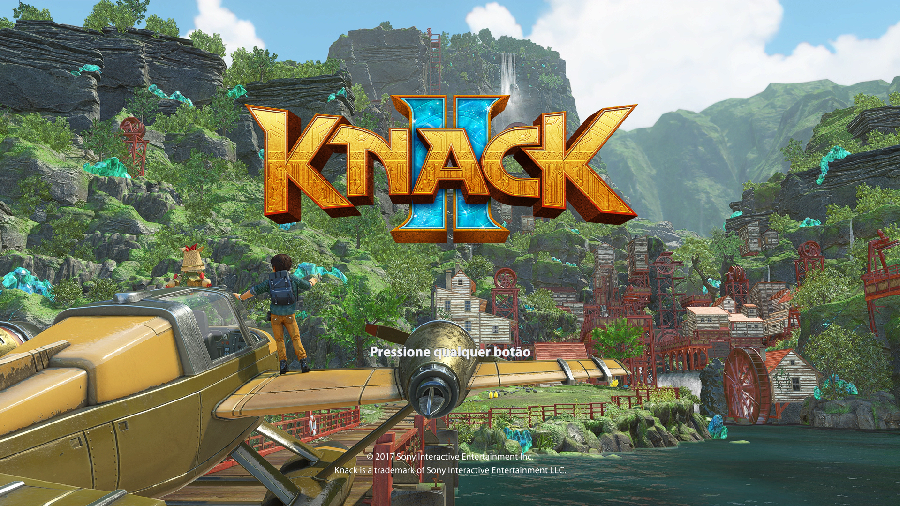
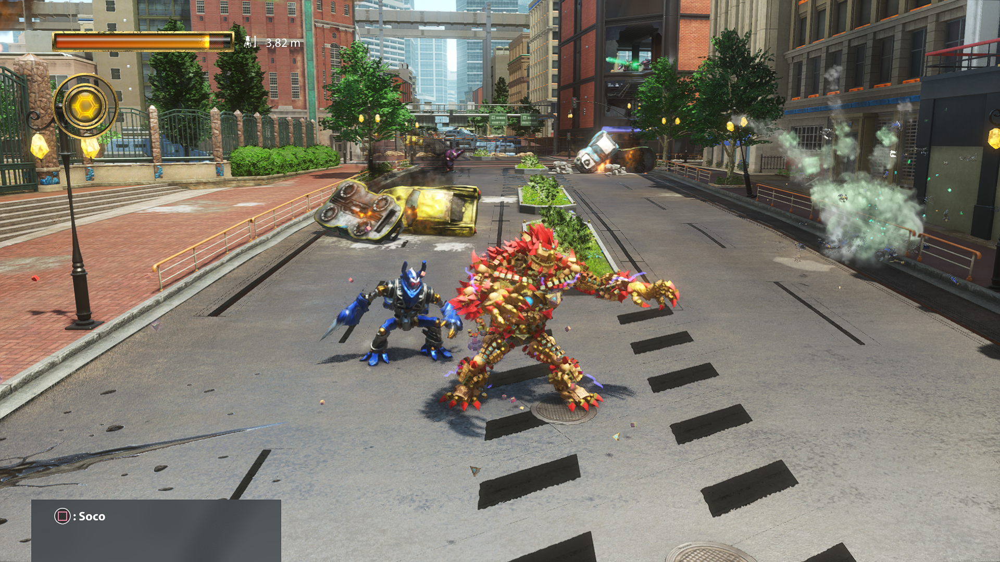

  

<h1 align="center">Knack II — PC Port</h1>

  <strong>Play Knack II on Windows with Vulkan graphics, a dedicated launcher and local two-player co-op.</strong>

  
  

  <a href="README.pt-BR.md">Português (Brasil)</a>
  · <a href="https://github.com/Hyant4/Knack-II-pc-port/releases">Releases</a>
  · <a href="https://hyant4.github.io/Knack-II-pc-port/">Website</a>
  · <a href="https://github.com/Hyant4/Knack-II-pc-port/issues">Report an issue</a>

  
  
  

---

> **Experimental, unofficial community port.** The project owner reports that the game is playable from beginning to end, including local co-op. The published automated tests and limited hands-on checks are **not** an independent full-campaign or cross-hardware certification. Visual issues, Vulkan device loss, and crashes may still occur.

## Play it

1. Download [**Knack-II-Windows-x64-V0.17.5.zip**](https://github.com/Hyant4/Knack-II-pc-port/releases/download/knack2-Version-0.17.5/Knack-II-Windows-x64-V0.17.5.zip) from the [V0.17.5 release](https://github.com/Hyant4/Knack-II-pc-port/releases/tag/knack2-Version-0.17.5).

> **Hotfix V0.17.1:** gameplay ultrawide keeps object proportions at 21:9/32:9. Opening and pre-rendered cutscenes use centered 16:9 framing with black side bars; gameplay aspect returns after loading.

> **V0.17.3:** experimental shader preloading is enabled by default; disable it in Settings / Video. Startup may take longer, and stutters can still occur. Stable 60 FPS is not guaranteed.

> **V0.17.2 launcher update:** choose PT / EN / RU from the launcher header. The selection is saved separately from the game language. Runtime remains byte-identical to V0.17.1.
2. Extract the entire ZIP; do not run the launcher from inside the archive.
3. Open `Knack II.exe`.
4. Choose your own Knack II game dump containing `eboot.bin`, `game.elf`, `sce_sys`, and `sce_module`, then select **Validate**.
5. Configure language, graphics, and one or two local players, then select **Play**.

**Game versions:** CUSA08014 (US, version 01.01) remains the primary tested target. V0.16 adds experimental recognition/support for **CUSA07670 (European)**; only a short boot with a temporary save was validated for that edition. Extended European gameplay and complete voice/subtitle compatibility are **not certified**.

The Windows ZIP contains the launcher, runtime, and needed dependencies. It contains **no game data, dump, firmware, or saves**.

## What's new in V0.17

| Area | V0.17 status |
| --- | --- |
| Native QHD & 4K | Internal resolution presets (2560×1440 and 3840×2160) configuring native render targets and framebuffer up to 4K. |
| Adaptive Presentation | High-resolution final framebuffer is adaptively presented on user displays (including 1080p). |
| Memory Headroom | Graphics pool headroom expanded (768 MiB for QHD, 1536 MiB for 4K; `TLG_DMEM_MB=5824/6592`) preventing OOM. |
| Launcher Selector | New internal resolution selector in launcher UI; restart required to apply settings. |
| European edition | CUSA07670 profile and language recognition retained; native resolution guards validated. |
| Ultrawide Caveat | Experimental widescreen retained. Cutscenes may show blue side areas; use 16:9 for exact framing. |

**Known limitation:** The cutscene framing defect was **not fixed** in this release. Unsuccessful experimental patches were excluded from the validated packages.

**Release validation:** 190 tests passed, 4 were skipped, with no reported test failures. Those results do not replace full gameplay testing; see the [release notes](https://github.com/Hyant4/Knack-II-pc-port/releases/tag/knack2-Version-0.17) for the precise validation scope.

## What works today

| Area | Evidence and limit |
| --- | --- |
| Launcher | Validates a local dump, remembers its location, and starts the supervised runtime. |
| Game and co-op | The project owner reports playability from start to finish; local two-player co-op was specifically exercised through Chapter 2. Full end-to-end regression and all hardware combinations were not independently certified. |
| US game edition | CUSA08014 / version 01.01 is the primary supported configuration. |
| European edition | CUSA07670 support is experimental and had only a short boot/save validation. Full campaign, languages, and audio are not yet certified. |
| Graphics | Vulkan-capable GPU and up-to-date drivers required. Ultrawide and cutscene presentation remain experimental. |
| Saves | Saves and preferences live in `%LOCALAPPDATA%\KnackII-PC`; solo and co-op use the selected profile. |
| Stability | Graphical defects, Vulkan device loss, or crashes may still occur. |

  

## Requirements

- Recent 64-bit Windows.
- Vulkan-capable GPU with an up-to-date driver.
- Your own Knack II dump: **CUSA08014 / 01.01** (primary target), or **CUSA07670** (European, limited testing).
- Two controllers if you want local two-player co-op.
- Source builds only: for game sound, `libSceNgs2.sprx` from your own console firmware in `firmware/` (or `KNACK2_SYSTEM_MODULES`, or shadPS4's `sys_modules`). Without it the runtime's NGS2 placeholder plays silence.

The Windows release ZIP bundles its runtime dependencies. No separate Python, Qt, or MSYS2 installation is required to play.

## Saves, settings, and logs

Saves, preferences, caches, and launcher logs are stored under `%LOCALAPPDATA%\KnackII-PC`.

Keep the game closed before changing or copying save files. The launcher keeps solo and co-op on the shared profile selected by the project configuration. See the [Windows launcher guide](docs/LAUNCHER_WINDOWS.md) for controls, language, profiles, and logs.

If a problem occurs, use **View logs** in the launcher and open an [issue](https://github.com/Hyant4/Knack-II-pc-port/issues) with your GPU, driver, selected game stage, and a short reproduction path. Do not attach game files, saves, or private paths.

## Build from source

**Source availability:** V0.17.5 does not include a dedicated source ZIP asset. The latest earlier attached snapshot is [**Knack-II-sources-V0.17.3.zip**](https://github.com/Hyant4/Knack-II-pc-port/releases/download/knack2-Version-0.17.3/Knack-II-sources-V0.17.3.zip). It does **not** fully match the V0.17.5 launcher binaries; review subsequent repository history for those changes. Verify the V0.17.5 download with its [SHA256SUMS.txt](https://github.com/Hyant4/Knack-II-pc-port/releases/download/knack2-Version-0.17.5/SHA256SUMS.txt).

Development requires Windows, MSYS2 CLANG64, Python tooling, Vulkan development dependencies, and your own compatible game dump. See the [Windows development guide](docs/DESENVOLVIMENTO_WINDOWS.md). No game or firmware files are distributed with the sources.

## How it works

| Layer | Role |
| --- | --- |
| Guest runtime | Runs the original x86-64 game code and reimplements required PS4-facing services. |
| Graphics | Translates the game's Gnm/GCN graphics work through a Vulkan backend derived from shadPS4 work. |
| Audio | Provides AudioOut, codec paths, source mixing, and Windows device delivery. |
| Launcher | Validates the dump, keeps local settings, manages players, and starts the supervised session. |

## Support the project

Knack II PC Port is a free, unofficial community project. If you'd like to support its continued development, you can [**buy me a coffee ☕**](https://buymeacoffee.com/hyant4). Donations are entirely optional and do not include game files or exclusive access.

## Credits and legal notice

This project builds on [HayatoG/iss_pc](https://github.com/HayatoG/iss_pc), shadPS4-derived graphics work, and other open-source projects. See [credits and third-party licenses](docs/CREDITS.md).

**Independent, unofficial community project.** It is not affiliated with or endorsed by Sony Interactive Entertainment. Knack II belongs to its respective rights holders. No game assets, firmware, or game dump are included.

For the exact V0.17 Windows and source archive hashes, use [SHA256SUMS.txt](https://github.com/Hyant4/Knack-II-pc-port/releases/download/knack2-Version-0.17/SHA256SUMS.txt).
