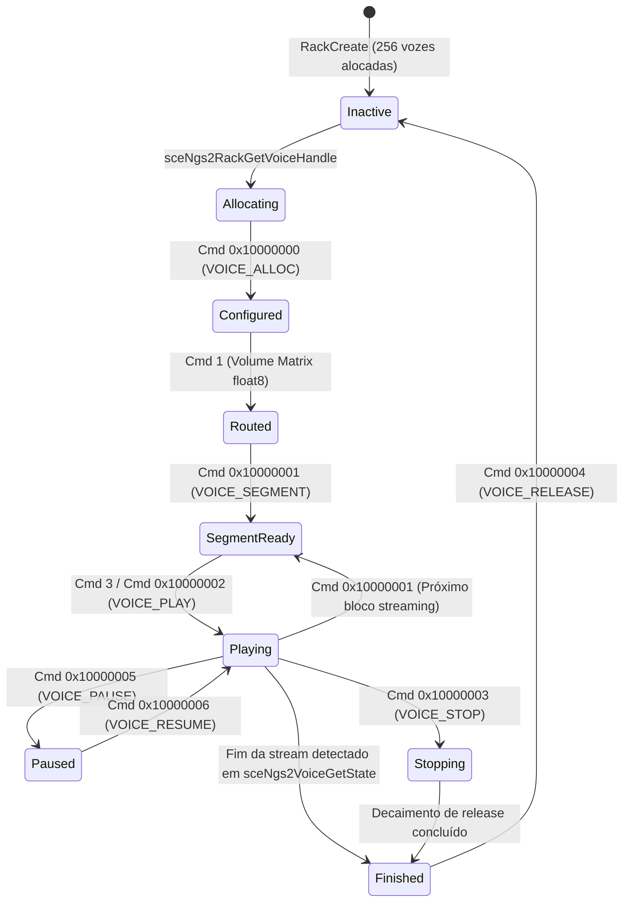
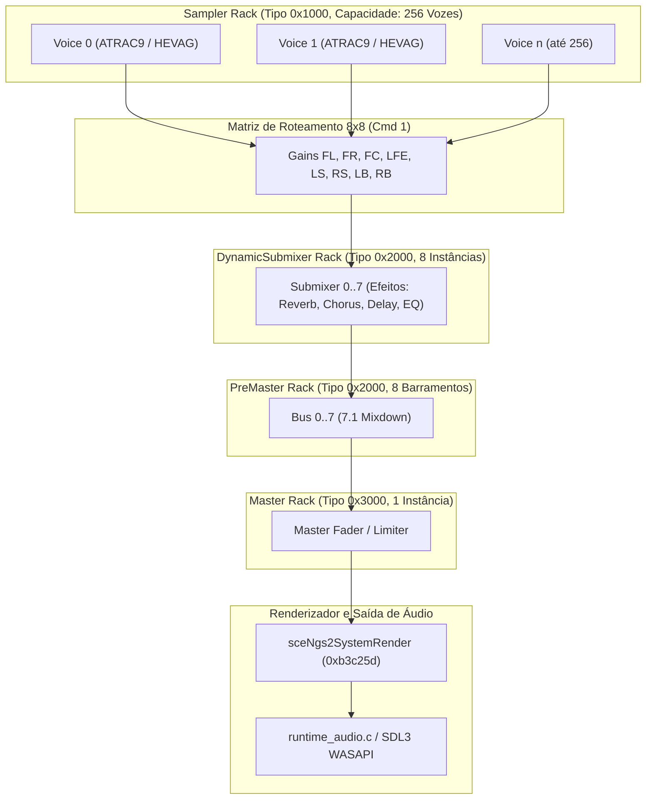
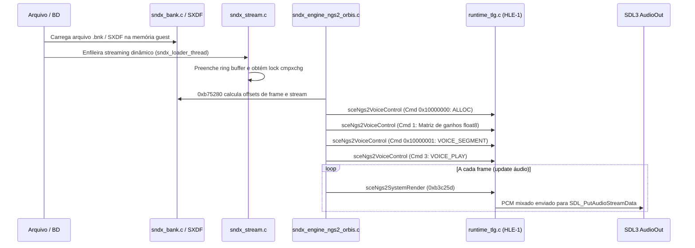

# Contratos HLE de libSceNgs2 e SoundX — Knack 2 PC Port

> **Documento:** `docs/ngs2_hle_contracts.md`  
> **Status:** Documentação permanente de engenharia reversa estática  
> **Marco:** Gate HLE-2.0 — Rastreamento de Waveform e Documentação  
> **Executor:** Gemini (Google Antigravity)  
> **Tech Leads:** GPT-6 e Argon  
> **Governança:** AGENTS.MD v2.2 — Knack 2 (CUSA08014, Perfil 01.01)  
> **Branch:** `knack2-windows` | **Commit Base:** `5664a07`  

---

## 1. Identificação do Jogo e Versão do Binário Analisado

| Propriedade | Valor | Detalhes |
|---|---|---|
| **Título** | Knack 2 | CUSA08014 |
| **Perfil** | 01.01 | Versão de lançamento para PlayStation 4 (Orbis OS) |
| **Imagem Analisada** | `out/knack2/game_elf/boot-linked.bin` | Imagem G3PROBE5 linkada e relocada |
| **Header Probe** | Magic: `G3PROBE5` | `img_size = 0x1b10090` (28.377.232 bytes), `entry = 0x80` |
| **Segmento de Código** | Segmento 0 (`game.elf`) | `vaddr = 0x00000000..0x011ff73c`, flags = RX (permissões de leitura/execução) |
| **Offset da Imagem no Arquivo** | `0x122fc0` | Cabeçalho G3PROBE5 com 12 segmentos, 3 módulos, 263 blocos e 880 imports |
| **Engine de Áudio Identificada** | Sony SoundX Orbis Engine | `C:\sound\sndx\trunk\runtime\source\sndx\sndx_engine_ngs2_orbis.c` |
| **Timestamp de Build do SoundX** | `May 1 2017 18:19:54` | Embutido na string em `0xd8217c..0xd8218f` |

---

## 2. Metodologia e Limitações

### Metodologia
1. **Desmontagem Estática Precisa:** Executada via biblioteca `iced-x86` (AMD64 / AVX / FMA) diretamente sobre o segmento executável do `game.elf` na imagem `boot-linked.bin`.
2. **Resolução de Símbolos e PLT/GOT:** Mapeamento completo dos 11 símbolos importados de `libSceNgs2` através da tabela de relocação e identificação das entradas de PLT correspondentes (`0xc83b10..0xc83c80`).
3. **Rastreamento de Fluxo de Dados e Controle:**
   - Desmontagem e análise da rotina de despacho de voz do SoundX (`0xb2b1f0..0xb2dbe0`).
   - Rastreamento de chamadas ao comando de controle de voz `sceNgs2VoiceControl` (`0xc83c80`).
   - Rastreamento dos cálculos de matriz de ganho e volumes (`0xb75560`, `0xb75760`, `0xb2bc00..0xb2bc50`).
   - Análise do extrator de metadados de frames e cues (`0xb75280`).
   - Inspeção de strings literais de debug (`0xd7f700..0xd83000`) deixadas pelo compilador do SoundX.
4. **Verificação Matemática:** Extração direta de constantes em ponto flutuante em memória estática (`.rodata`), confirmando valores e representações IEEE 754.

### Limitações
- **Análise 100% Estática:** Conforme estabelecido por `AGENTS.MD` v2.2, nenhum executável foi executado dinamicamente, nenhum arquivo protegido foi alterado e nenhum arquivo de save foi modificado.
- **Buffers de Streaming em Tempo de Execução:** Endereços absolutos e preenchimento dos ring buffers de streaming dependem de alocadores em tempo de execução (`sndx_stream.c`). Seu comportamento estático foi mapeado, mas a captura de ponteiros concretos requer instrumentação passiva em tempo de execução pelo GPT-5.6 Sol.

---

## 3. Layouts de Estruturas com Offsets e Larguras

### 3.1. Estrutura de Comando Genérico `SceNgs2VoiceControl`

Todas as chamadas à API `sceNgs2VoiceControl(SceNgs2Handle handle, const void *pCommand)` utilizam pacotes de comando com cabeçalho padrão de 8 bytes seguido por parâmetros específicos:

```c
// Cabeçalho comum de comando NGS2
struct SceNgs2VoiceControlHeader {
    uint16_t size;        // Tamanho total da estrutura em bytes
    uint16_t reserved;    // Sempre 0
    uint32_t commandId;   // Identificador do comando (ex: 1, 3, 0x10000000, 0x10000001)
};
```

---

### 3.2. Comando `0x10000000`: `SceNgs2VoiceAlloc` (`VOICE_ALLOC`)
Configurado em `0xb2ba50..0xb2bac5` (e rotinas correlatas em `0xb2a680..0xb2a830`). Tamanho total = 40 bytes (`0x28`).

```c
struct SceNgs2VoiceAllocCmd {
    // Cabeçalho (8 bytes)
    uint16_t size;          // +0x00: 0x0028 (40 bytes)
    uint16_t reserved;      // +0x02: 0x0000
    uint32_t commandId;     // +0x04: 0x10000000 (SceNgs2SamplerVoiceAlloc)
    
    // Parâmetros do Payload (32 bytes)
    uint32_t format;        // +0x08: Formato do áudio (0x42 = ATRAC9, 0x21 = HEVAG / Channel)
    uint32_t numChannels;   // +0x0C: Quantidade de canais (1 = mono, 2 = stereo, etc.)
    uint32_t sampleRate;    // +0x10: Frequência de amostragem (0xBB80 = 48000 Hz fixo)
    uint32_t codecConfig;   // +0x14: Configuração de superframe ATRAC9 (r9d vindo de 0xb75280)
    uint32_t streamOffset;  // +0x18: Offset de início acumulado em bytes no banco/stream (r13d)
    uint32_t streamSize;    // +0x1C: Tamanho em bytes do bloco/frame da stream (r14d)
    uint32_t flagReserved;  // +0x20: Flag (0 ou 1, dependendo de [rax+8] em 0xb2b9e1)
    uint32_t reserved2;     // +0x24: Sempre 0
};
```

---

### 3.3. Comando `1`: Matriz de Roteamento de Canais e Envio de Ganhos
Configurado em `0xb2c149..0xb2c18d`. Tamanho total = 24 bytes (`0x18`).

```c
struct SceNgs2VoiceRoutingMatrixCmd {
    // Cabeçalho (8 bytes)
    uint16_t size;          // +0x00: 0x0018 (24 bytes)
    uint16_t reserved;      // +0x02: 0x0000
    uint32_t commandId;     // +0x04: 0x00000001 (Routing Matrix / Gain setup)
    
    // Parâmetros do Payload (16 bytes)
    uint32_t startIndex;    // +0x08: Índice inicial (0)
    uint32_t count;         // +0x0C: Total de coeficientes float = numChannels * 8 (ebx << 3)
    uint64_t bufferGuest;   // +0x10: Ponteiro guest de 64 bits para array float[numChannels * 8]
};
```

---

### 3.4. Comando `0x10000001`: `SceNgs2VoiceSegment` (`VOICE_SEGMENT`)
Configurado em `0xb2d840..0xb2d8fe`. Tamanho total = 32 bytes (`0x20`).

```c
struct SceNgs2VoiceSegmentCmd {
    // Cabeçalho (8 bytes)
    uint16_t size;          // +0x00: 0x0020 (32 bytes)
    uint16_t reserved;      // +0x02: 0x0000
    uint32_t commandId;     // +0x04: 0x10000001 (VOICE_SEGMENT)
    
    // Parâmetros do Payload (24 bytes)
    uint64_t blockHandle;   // +0x08: Descritor/Handle de bloco ou buffer do streaming ([r15+rbx*8])
    uint32_t flag1;         // +0x10: 1
    uint32_t flag2;         // +0x14: 1
    uint64_t pSegmentBlock; // +0x18: Ponteiro guest de 64 bits para struct SceNgs2VoiceSegmentBlock
};

// Estrutura apontada por pSegmentBlock (alocada na stack em rsp+1C0h, 32 bytes)
struct SceNgs2VoiceSegmentBlock {
    uint32_t unk0;          // +0x00: 0
    uint32_t sampleCount;   // +0x04: [r15+rbx*8+8] (quantidade de samples/frames)
    uint32_t loopFlag;      // +0x08: [r15+rbx*8+11h] - 1 (indicador de fim ou loop)
    uint32_t blockIndex;    // +0x0C: [r15+rbx*8+12h] (índice ou identificador do bloco)
    uint32_t dataOffset;    // +0x10: [r15+rbx*8+14h] (offset de dados)
    uint32_t unk14;         // +0x14: 0
    uint64_t unk18;         // +0x18: 0
};
```

---

### 3.5. Estrutura de Descrição de Rack `SceNgs2RackDescription`
Construída pelo SoundX em `0xb29580..0xb29950`. Tamanho total = 168 bytes (`0xA8`).

```c
struct SceNgs2RackDescription {
    uint32_t size;          // +0x00: 0x000000A8 (168 bytes)
    uint32_t reserved0;     // +0x04: 0
    char     name[24];      // +0x08: "Sampler\0", "Master\0", "PreMaster\0", "DynamicSubmixer\0"
    uint32_t reserved1;     // +0x20: Alinhamento/flags
    uint32_t maxVoices;     // +0x24: 256 (0x100) para Sampler; 1 para Master; 8 para DynamicSubmixer
    uint32_t numChannels;   // +0x28: 8 canais (7.1 Surround)
    uint32_t sampleRate;    // +0x2C: 48000 Hz
    uint8_t  reserved2[112];// +0x30..0xA4: Buffers de alocação, slots de voz e configurações de barramento
    uint32_t flags;         // +0xA8: Flags de criação do rack
};
```

---

## 4. Tabelas de Comandos NGS2

| ID do Comando | Nome Comprovado no Log | Tamanho | Origem no Código | Significado Comprovado |
|---|---|---|---|---|
| `1` | `VOICE_ROUTING` | 24 B (`0x18`) | `0xb2c149..0xb2c18d` | Envia matriz de ganhos `float[numChannels * 8]` aos barramentos de saída |
| `3` | `VOICE_PLAY` / `KEY_ON` | 16 B (`0x10`) | `0xb2c192..0xb2c1c8` | Dispara o início da reprodução da voz |
| `0x10000000` | `VOICE_ALLOC_AT9` / `VOICE_ALLOC_CHANNEL` | 40 B (`0x28`) | `0xb2ba50..0xb2bac5` | Aloca a voz com formato (0x42/0x21), canais, 48kHz, codecConfig e limites de bytes |
| `0x10000001` | `VOICE_SEGMENT` | 32 B (`0x20`) | `0xb2d840..0xb2d8fe` | Alimenta a voz com um bloco de dados/streaming e parâmetros de frames |
| `0x10000002` | `VOICE_PLAY` | 16 B (`0x10`) | `0xb2c440..0xb2c454` | Controle de playback (play) |
| `0x10000003` | `VOICE_STOP` | 16 B (`0x10`) | `0xb2c4e0..0xb2c500` | Interrompe a reprodução da voz |
| `0x10000004` | `VOICE_RELEASE` | 16 B (`0x10`) | `0xb2c5a0..0xb2c5c0` | Libera a voz para o pool de vozes inativas |
| `0x10000005` | `VOICE_PITCH` / Freq | 16 B (`0x10`) | `0xb2bb16..0xb2bb55` | Ajusta a frequência/pitch da voz (`mulss` por constante `0xCE6C70`) |
| `0x10000008` | `VOICE_ADSR` / Filter | 40 B (`0x28`) | `0xb2bbd2..0xb2bbe7` | Configura envoltória ADSR e parâmetros de filtragem biquad |

---

## 5. Máquina de Estados de Voz do SoundX / NGS2



### Regras de Transição de Estado
1. **Verificação de Fim de Voz:** O SoundX consulta periodicamente `sceNgs2VoiceGetState` e `sceNgs2VoiceGetStateFlags`. Quando a voz termina a reprodução, o bit `0x20000` (`SCE_NGS2_VOICE_STATE_FLAG_FINISHED`) sinaliza que a voz deve emitir o log `VOICE_FINISHED` e ser liberada.
2. **Looping:** Se a voz é contínua (ex: música de fundo), o SoundX envia repetidas chamadas ao comando `0x10000001` (`VOICE_SEGMENT`) antes que os buffers existentes sofram starvation.

---

## 6. Topologia dos Racks

O SoundX instancia 4 racks no sistema NGS2 através de chamadas a `sceNgs2RackCreateWithAllocator`:



---

## 7. Formatos de Áudio

### 7.1. Formato `0x42` (66 decimal) — ATRAC9
- **Classificação:** **CONFIRMADO**.
- **Evidências:**
  - Despachado pela tabela de saltos em `0xD03634` (offset `0x42 * 4` salta para `0xb2a797`).
  - Emite a mensagem explícita de log: `"$%x,$%p,%d:VOICE_ALLOC_AT9 %d/%d"` (`0xd7f7ac`).
  - Extrai o parâmetro de configuração do superframe ATRAC9 em `0xb75280` (`bextr` do cabeçalho da stream) e o transmite no campo `+0x14` do comando `0x10000000`.
  - Utilizado em todas as trilhas musicais e diálogos principais do Knack 2.

### 7.2. Formato `0x21` (33 decimal) — PS4 ADPCM / HEVAG
- **Classificação:** **CONFIRMADO** quanto à rota de despacho; **PROVÁVEL** quanto ao layout HEVAG/VAGp.
- **Evidências:**
  - Despachado pela tabela de saltos em `0xD03634` (offset `0x21 * 4` salta para `0xb2a633`).
  - Emite a mensagem explícita de log: `"$%x,$%p,%d:VOICE_ALLOC_CHANNEL %d/%d"` (`0xd7f7ce`).
  - Utiliza alocação de canais de voz discretos (típico de efeitos sonoros rápidos, pancadas, passos, partículas de relic).
  - A string `'VAGp'` está presente no analisador de formatos em `0xd8297f`.

### 7.3. Tabela Completa de Formatos Suportados pelo SoundX (Jump Table `0xD03634`)

| Código do Formato | Destino no Código | Rota Executada | Descrição Provável |
|---|---|---|---|
| `0x00`, `0x01` | `0xb2a633` | `VOICE_ALLOC_CHANNEL` | PCM Linear 16-bit Mono/Stereo |
| `0x04`, `0x05` | `0xb2a633` | `VOICE_ALLOC_CHANNEL` | PCM Linear 24-bit / 32-bit Float |
| `0x08`, `0x09` | `0xb2a633` | `VOICE_ALLOC_CHANNEL` | ADPCM Básico |
| `0x0C`, `0x0D` | `0xb2a633` | `VOICE_ALLOC_CHANNEL` | ADPCM Multicanal |
| `0x10`, `0x11` | `0xb2a633` | `VOICE_ALLOC_CHANNEL` | VAG / HEVAG Mono |
| `0x14`, `0x15` | `0xb2a633` | `VOICE_ALLOC_CHANNEL` | VAG / HEVAG Stereo |
| `0x20`, `0x21`, `0x22` | `0xb2a633` | `VOICE_ALLOC_CHANNEL` | **HEVAG PS4** com tabelas de coeficiente |
| `0x28` | `0xb2a633` | `VOICE_ALLOC_CHANNEL` | HEVAG Streaming |
| `0x30` até `0x35` | `0xb2a633` | `VOICE_ALLOC_CHANNEL` | Formatos de barramento e geradores internos |
| `0x42` | `0xb2a797` | `VOICE_ALLOC_AT9` | **ATRAC9 Multicanal** (Sony ATRAC9) |
| Qualquer outro | `0xb2a77a` | Erro `0xb29ed0` | `"Unsupported waveform type (%d)"` (`0xd7f7f4`) |

---

## 8. Fluxo dos Dados SoundX → NGS2



---

## 9. Origem, Endereçamento e Lifetime dos Buffers

### 9.1. Análise Exaustiva dos Oito Dwords do Comando 1 (`0xb2c18d`)
- **Origem:** Gerados pelo cálculo de matriz de pan/bus em `0xb75560` / `0xb75760`.
- **Armazenamento:** Gravados via vetor AVX `vmovups [rbx+4Ch], ymm6` no descritor de canal da voz (`rbx`).
- **Valores Inicializadores:** Carregados a partir da constante de 256 bits em `0xCDD8E0`, contendo exatamente `(1.0f, 1.0f, 1.0f, 1.0f, 1.0f, 1.0f, 1.0f, 1.0f)` (ganho unitário nos 8 canais).
- **Modulação:** Multiplicados por atenuação de distância 3D, ganho mestre da voz e faders de barramento.
- **Tabela dos Oito Dwords por Canal:**

| Dword | Offset no Canal | Registrador AVX | Barramento de Saída Mapeado | Significado Físico |
|---|---|---|---|---|
| **Dword 0** | `rbx + 0x4C` | `ymm6[0]` | Canal 0: Front-Left (`fl`) | Ganho linear de envio Front-Left |
| **Dword 1** | `rbx + 0x50` | `ymm6[1]` | Canal 1: Front-Right (`fr`) | Ganho linear de envio Front-Right |
| **Dword 2** | `rbx + 0x54` | `ymm6[2]` | Canal 2: Front-Center (`fc`) | Ganho linear de envio Central |
| **Dword 3** | `rbx + 0x58` | `ymm6[3]` | Canal 3: Low-Freq Effects (`lfe`)| Ganho de subwoofer / graves |
| **Dword 4** | `rbx + 0x5C` | `ymm6[4]` | Canal 4: Left-Surround (`ls`) | Ganho de surround lateral esquerdo |
| **Dword 5** | `rbx + 0x60` | `ymm6[5]` | Canal 5: Right-Surround (`rs`)| Ganho de surround lateral direito |
| **Dword 6** | `rbx + 0x64` | `ymm6[6]` | Canal 6: Left-Back (`lb`) | Ganho de surround traseiro esquerdo |
| **Dword 7** | `rbx + 0x68` | `ymm6[7]` | Canal 7: Right-Back (`rb`) | Ganho de surround traseiro direito |

> [!IMPORTANT]
> **Nenhum dos oito dwords do comando 1 contém ponteiro ou endereço de memória.** Todos os 8 campos são estritamente coeficientes de volume de ponto flutuante de 32 bits (`float`). Tentar dereferenciá-los como ponteiros guest resultará imediatamente em crash ou violação de memória.

---

### 9.2. Origem dos Campos `+0x18` e `+0x1C` do Comando `0x10000000`
- **Offset `+0x18` (`streamOffset`):** Carregado a partir de `r13d` (`[rsp+0B4h]`). É produzido em `0xb75534` (`mov [rax+0Ch], r15d`) dentro da rotina `0xb75280`. Representa o **byte offset acumulado** dentro do arquivo de som / banco SXDF correspondente ao primeiro frame da cue selecionada.
- **Offset `+0x1C` (`streamSize`):** Carregado a partir de `r14d` (`[rsp+0B8h]`). É produzido em `0xb7543b` (`mov [rdx+10h], ecx`) onde `ecx = [rsi+8] - edi` dentro de `0xb75280`. Representa o **comprimento total em bytes** do segmento ou do bloco de áudio a ser decodificado.

---

### 9.3. Onde Residem os Bytes Reais de Áudio e Lifetime
1. **Bancos Estáticos (SXDF Sound Banks):**
   - Áudio residente (efeitos sonoros, UI, impactos).
   - O arquivo do banco é lido na íntegra para a memória heap do guest pelo subsistema de carregamento (`sndxs_file_request.c`).
   - Os dados residem estavelmente em memória durante todo o ciclo de vida do banco (entre `sceSndxBankRegister` e `sceSndxBankUnregister`).
2. **Streams Dinâmicos (BGM / Vozes Longas):**
   - Música de fundo e diálogos longos.
   - Gerenciados por `sndx_stream.c` através de um ring buffer de streaming (`[r13+568h]`) protegido por spinlock atômico (`0xb6e44a: lock cmpxchg`).
   - Os ponteiros de memória guest reais para os blocos da stream são transferidos via comando `0x10000001` (`VOICE_SEGMENT`), onde o campo `+0x08` recebe o identificador do bloco e o campo `+0x18` aponta para `SceNgs2VoiceSegmentBlock`.
   - O lifetime de cada bloco de streaming é delimitado pela taxa de reprodução: após o decodificador consumir os frames descritos em `sampleCount`, o SoundX recicla o bloco de buffer.

---

## 10. Riscos de ABI e Memória

1. **Convenção de Chamada SysV AMD64:**
   - Em Orbis OS, argumentos de inteiros e ponteiros são passados em `RDI`, `RSI`, `RDX`, `RCX`, `R8`, `R9`.
   - Argumentos flutuantes são passados em `XMM0` até `XMM7`.
   - O retorno de inteiros é em `RAX`, e flutuantes em `XMM0`.
   - O alinhamento de pilha antes de qualquer `CALL` deve ser rigorosamente de 16 bytes (`rsp % 16 == 8` na entrada da função).
2. **Alinhamento e Operações AVX:**
   - O SoundX utiliza amplamente instruções AVX de 256 bits (`vmovups`, `vmovdqu`, `ymm0`..`ymm7`).
   - A pilha é alinhada em 32 bytes (`and rsp, -32` em `0xb2b1fd` e `0xb7556d`).
   - Quaisquer acessos às estruturas do NGS2 pelo runtime HLE devem respeitar larguras nativas de 64 bits para ponteiros e não fazer suposição de alinhamentos não garantidos pela ABI.
3. **Perigo de Tipo em `Cmd 1` e `Cmd 0x10000000`:**
   - Não tratar os dwords de volume de `Cmd 1` como ponteiros de dados de áudio.
   - Não tentar ler o payload de áudio a partir do endereço base de `Cmd 0x10000000`: este comando transporta metadados e limites (`streamOffset`, `streamSize`), mas o ponteiro do ring buffer é suprido via `Cmd 0x10000001` (`VOICE_SEGMENT`).

---

## 11. Pendências para Gate HLE-2.1

1. **Instrumentação Passiva de Captura de Segmentos:**
   - O GPT-5.6 Sol deve adicionar uma linha de log passivo (`TLG_INFO`) em `sceNgs2VoiceControl` ao receber o comando `0x10000001` (`VOICE_SEGMENT`) para imprimir o ponteiro `blockHandle` e os primeiros 16 bytes do bloco.
   - Objetivo: confirmar visualmente os sync words do ATRAC9 (`0xFF` e identificador de superframe) ou de HEVAG antes de ligar o decodificador.
2. **Implementação do Decodificador ATRAC9 (Formato `0x42`):**
   - Integrar `LibAtrac9` (já presente em `port/third_party/LibAtrac9`) à rotina de processamento de voz no `runtime_tlg.c`.
   - Utilizar a palavra de configuração do superframe obtida no comando `0x10000000` (`+0x14`).
3. **Mixagem Multicanal 8x8:**
   - Aplicar a matriz de 8 ganhos (`Cmd 1`) aos canais decodificados durante a execução de `sceNgs2SystemRender`.
   - Direcionar os 8 canais somados ao PreMaster e ao Master, com saída no stream WASAPI SDL3 existente.

---

## 12. Referências a Endereços do Disassembly

| Endereço Virtual | Mnemônico / Operação | Papel no Pipeline SoundX / NGS2 |
|---|---|---|
| `0xb289eb` | `mov [17E1810h], r12` | Inicialização da estrutura global do SoundX Orbis |
| `0xb295b1` | `mov esi, 3000h; call sceNgs2RackCreateWithAllocator` | Criação do rack **Master** (tipo 0x3000) |
| `0xb2969b` | `mov esi, 2000h; call sceNgs2RackCreateWithAllocator` | Criação do rack **PreMaster** (tipo 0x2000) |
| `0xb297c3` | `mov esi, 1000h; call sceNgs2RackCreateWithAllocator` | Criação do rack **Sampler** (tipo 0x1000, 256 vozes) |
| `0xb2984d` | `mov esi, 2000h; call sceNgs2RackCreateWithAllocator` | Criação do rack **DynamicSubmixer** (tipo 0x2000) |
| `0xb2a615` | `cmp r8, 42h; ja 0xb2a77a` | Validação de formato de áudio |
| `0xb2a633` | `call 0xb74a80` | Rota do formato `0x21` (`VOICE_ALLOC_CHANNEL`) |
| `0xb2a797` | `call 0xb74a80` | Rota do formato `0x42` (`VOICE_ALLOC_AT9`) |
| `0xb2b1f0` | `push rbp; and rsp, -32` | Função central de despacho de eventos de voz SoundX |
| `0xb2b7c1` | `call 0xb75280` | Extração de metadados de frames e cues |
| `0xb2ba50..0xb2bac5` | `call 0xc83c80 (sceNgs2VoiceControl)` | Envio do comando `0x10000000` (`VOICE_ALLOC`) |
| `0xb2bc4b` | `vmovups [rbx+4Ch], ymm6` | Gravação dos 8 floats de ganho no descritor de canal |
| `0xb2bef7..0xb2c0fe` | `mov [rsp+rsi*4+0C0h], ebx` | Empacotamento dos 8 dwords por canal na stack |
| `0xb2c18d` | `call 0xc83c80 (sceNgs2VoiceControl)` | Envio do comando `1` (Routing Matrix float8) |
| `0xb2c1c8` | `call 0xc83c80 (sceNgs2VoiceControl)` | Envio do comando `3` (VOICE_PLAY / KEY_ON) |
| `0xb2d8a0..0xb2d8fe` | `call 0xc83c80 (sceNgs2VoiceControl)` | Envio do comando `0x10000001` (`VOICE_SEGMENT`) |
| `0xb3c25d` | `call 0xc83bb0 (sceNgs2SystemRender)` | Chamada por frame para renderização dos racks |
| `0xb662c4` | `cmp dword ptr [r12], 46445853h ('SXDF')` | Validação do cabeçalho de banco de som SoundX |
| `0xb6e44a` | `lock cmpxchg [r12+18h], r15d` | Spinlock atômico do buffer circular de streaming |
| `0xCDD8E0` | `1.0f, 1.0f, 1.0f, 1.0f, 1.0f, 1.0f, 1.0f, 1.0f` | Matriz identidade de ganhos 7.1 em `.rodata` |
| `0xd7f702` | String de caminho de código | `C:\sound\sndx\trunk\runtime\source\sndx\sndx_engine_ngs2_orbis.c` |
| `0xd8207e` | String de caminho de streaming | `C:\sound\sndx\trunk\runtime\source\sndx\sndx_stream.c` |
| `0xd8212c` | String de caminho do sistema | `C:\sound\sndx\trunk\runtime\source\sndx\sndx_system.c` |
